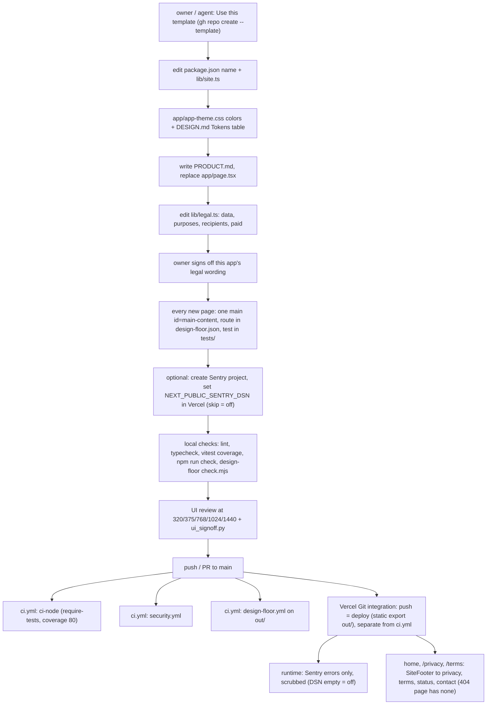

# 01 — Business process (As-Is / To-Be)

web-starter คือ GitHub template สำหรับเริ่มเว็บใหม่ทุกตัวของ owner: Next.js 16 static export ที่ผ่าน design floor ADR-0007, มีฟอนต์ไทย self-hosted, Sentry แบบ scrub, legal kit (privacy / terms) และ CI มาตรฐานตั้งแต่ commit แรก ผู้ใช้คือ owner และ agent ที่สร้างแอปใหม่

Last reviewed: 2026-11-28 · commit `8e16742`

## As-Is (จากโค้ดวันนี้)

Sources: `README.md` §Start a new app, §Legal kit, §Checks, `.github/workflows/ci.yml`, `next.config.ts` (`output: 'export'`), `package.json` scripts, `design-floor.json`, `lib/site.ts`, `lib/legal.ts`, `lib/sentry.ts`, `instrumentation-client.ts`, `app/site-footer.tsx`, `app/page.tsx`, `app/legal-page.tsx`, `app/not-found.tsx`, `app/layout.tsx`, `AGENTS.md`

ข้อเท็จจริงจากโค้ด:

- `ci.yml` pin `ci-node.yml` ที่ `v1.1.1`, `security.yml` ที่ `v1.6.6`, `design-floor.yml` ที่ `v1.5.11`
- Vercel deploy ไม่ได้อยู่ใน `ci.yml` (Vercel Git integration ตาม README ขั้น 7): push เริ่ม deploy เอง ไม่ได้รอผล CI และ `ci.yml` ไม่มี gate ใดกั้น deploy; ว่า repo นี้เองมี Vercel project หรือตั้งให้รอ check หรือไม่ [ต้องยืนยัน]
- `lib/legal.ts` และ README §Legal kit: ถ้อยคำเป็น baseline ภาษาง่าย ไม่ใช่คำแนะนำทางกฎหมาย เจ้าของต้อง sign off ถ้อยคำที่ปรับให้แต่ละแอปก่อนเผยแพร่
- `AGENTS.md`: ทุกหน้าใหม่ต้องมี `<main id="main-content">` หนึ่งอัน, route ใน `design-floor.json` และ test ใน `tests/`
- Sentry เปิดได้เมื่อสร้าง project และตั้ง `NEXT_PUBLIC_SENTRY_DSN` ใน Vercel (README ขั้น 6); ไม่ตั้ง = ปิด
- `SiteFooter` ใส่ใน `app/page.tsx` และ `app/legal-page.tsx` (privacy, terms) เท่านั้น; `app/layout.tsx` ไม่ได้ใส่ให้ทุกหน้า และ `app/not-found.tsx` ไม่มี footer
- `design-floor.json` ใช้ `"floor": "1.0.0"` และ `target.static: out`
- README §Private repo: private repo ต้องรัน design floor ในเครื่อง เพราะ self-hosted runner ยังไม่มี library ของ Chromium

## To-Be

ไม่มี To-Be ที่เขียนไว้

`PRODUCT.md` เป็นแม่แบบให้แอปใหม่กรอก มีเพียงประโยคเดียวสำหรับ starter เอง ("ทุกเว็บใหม่เริ่มจาก repo นี้") ไม่มี spec, ADR หรือ roadmap ของ starter ใน repo

## Gap

| ID | As-Is → To-Be | Status | Owner | Evidence |
|---|---|---|---|---|
| G1 | ไม่มี To-Be ที่เขียนไว้สำหรับตัว starter (เช่น เวอร์ชัน workflow ที่ต้อง pin, ขั้น deploy-smoke, legal sign-off) → owner กำหนด To-Be; owner ตัดสิน 2026-11-28: claude ร่าง To-Be (pin reusable CI ที่ v1.6.6, ขั้น deploy-smoke, design floor 12/12) แล้ว owner อนุมัติ | todo | claude | `PRODUCT.md` (แม่แบบ); ไม่มี `specs/` หรือ `docs/adr/` |
| G2 | Vercel deploy เมื่อ push โดยไม่รอ CI → ให้ production deploy รอ `ci.yml` ผ่านหรือไม่ (เช่น ตั้งให้ Vercel รอ check); owner ตัดสิน 2026-11-28: ใช่ เฉพาะ template (แอปเดิมไม่เปลี่ยน): ใช้ `deploy-vercel.yml` ของ platform-ci-workflows (G1 ที่นั่น) ให้ deploy หลัง `ci.yml` ผ่าน; ก่อนใช้ต้องปิด Vercel Git auto-deploy ของ `main` (`git.deploymentEnabled.main: false` ใน `vercel.json`) ไม่งั้น push เข้า `main` ยัง deploy ก่อน CI ผ่านและอาจ deploy ซ้ำ | todo | claude | `README.md:24`; `.github/workflows/ci.yml` ไม่มีขั้น deploy หรือ gate |
| G3 | As-Is ลากลูกศรจาก `push / PR to main` ไป Vercel ทั้งที่ PR เริ่มแค่ CI ส่วน production deploy มาจาก push เข้า `main` → แยกสองทางเมื่อแก้ diagram ครั้งถัดไป (Codex review 2026-11-28, จดไว้แทนการวาดใหม่ตามที่ owner สั่ง) | todo | claude | `.github/workflows/ci.yml`; `README.md:24` |

## Open questions

- ถ้อยคำ baseline ของ starter เองใน `lib/legal.ts` owner sign off แล้วหรือไม่ (ไฟล์เขียนว่า "the owner signs off the wording"; แยกจากการ sign off ถ้อยคำของแต่ละแอปในแผนภาพ) [ต้องยืนยัน]
- `ci-node.yml` ยัง pin `v1.1.1` ขณะที่ workflow อื่นอยู่ `v1.6.x`; ควรให้แอปใหม่เริ่มที่ release ล่าสุดหรือไม่
- private repo จะรัน design floor ใน CI ได้เมื่อ runner image มี library ของ Chromium (ดู platform-ci-workflows `README.md` §Design floor)
