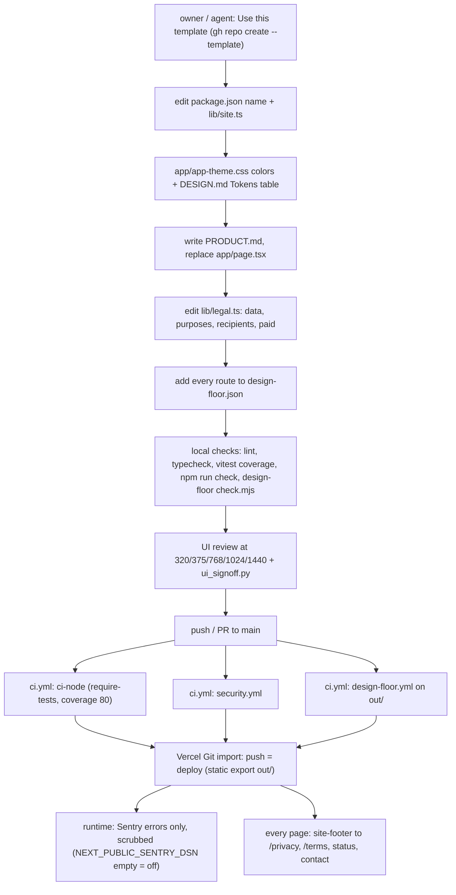

# 01 — Business process (As-Is / To-Be)

web-starter คือ GitHub template สำหรับเริ่มเว็บใหม่ทุกตัวของ owner: Next.js 16 static export ที่ผ่าน design floor ADR-0007, มีฟอนต์ไทย self-hosted, Sentry แบบ scrub, legal kit (privacy / terms) และ CI มาตรฐานตั้งแต่ commit แรก ผู้ใช้คือ owner และ agent ที่สร้างแอปใหม่

Last reviewed: 2026-11-28 · commit `8e16742`

## As-Is (จากโค้ดวันนี้)

Sources: `README.md` §Start a new app, §Checks, `.github/workflows/ci.yml`, `next.config.ts` (`output: 'export'`), `package.json` scripts, `design-floor.json`, `lib/site.ts`, `lib/legal.ts`, `lib/sentry.ts`, `instrumentation-client.ts`, `app/site-footer.tsx`, `AGENTS.md`

ข้อเท็จจริงจากโค้ด:

- `ci.yml` pin `ci-node.yml` ที่ `v1.1.1`, `security.yml` ที่ `v1.6.6`, `design-floor.yml` ที่ `v1.5.11`
- Vercel deploy ไม่ได้อยู่ใน `ci.yml` (Vercel Git integration ตาม README ขั้น 7) ว่า repo นี้เองมี Vercel project หรือไม่ [ต้องยืนยัน]
- `design-floor.json` ใช้ `"floor": "1.0.0"` และ `target.static: out`
- README §Private repo: private repo ต้องรัน design floor ในเครื่อง เพราะ self-hosted runner ยังไม่มี library ของ Chromium

## To-Be

ไม่มี To-Be ที่เขียนไว้

`PRODUCT.md` เป็นแม่แบบให้แอปใหม่กรอก มีเพียงประโยคเดียวสำหรับ starter เอง ("ทุกเว็บใหม่เริ่มจาก repo นี้") ไม่มี spec, ADR หรือ roadmap ของ starter ใน repo

## Gap

| ID | As-Is → To-Be | Status | Owner | Evidence |
|---|---|---|---|---|
| G1 | ไม่มี To-Be ที่เขียนไว้สำหรับตัว starter (เช่น เวอร์ชัน workflow ที่ต้อง pin, ขั้น deploy-smoke, legal sign-off) → owner กำหนด To-Be | decide | owner | `PRODUCT.md` (แม่แบบ); ไม่มี `specs/` หรือ `docs/adr/` |

## Open questions

- ถ้อยคำใน `lib/legal.ts` owner sign off แล้วหรือไม่ (ไฟล์เขียนว่า "the owner signs off the wording") [ต้องยืนยัน]
- `ci-node.yml` ยัง pin `v1.1.1` ขณะที่ workflow อื่นอยู่ `v1.6.x`; ควรให้แอปใหม่เริ่มที่ release ล่าสุดหรือไม่
- private repo จะรัน design floor ใน CI ได้เมื่อ runner image มี library ของ Chromium (ดู platform-ci-workflows `README.md` §Design floor)
